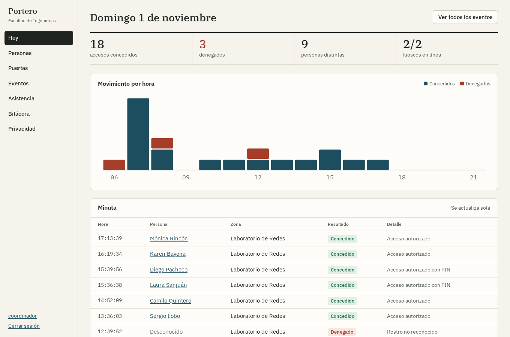
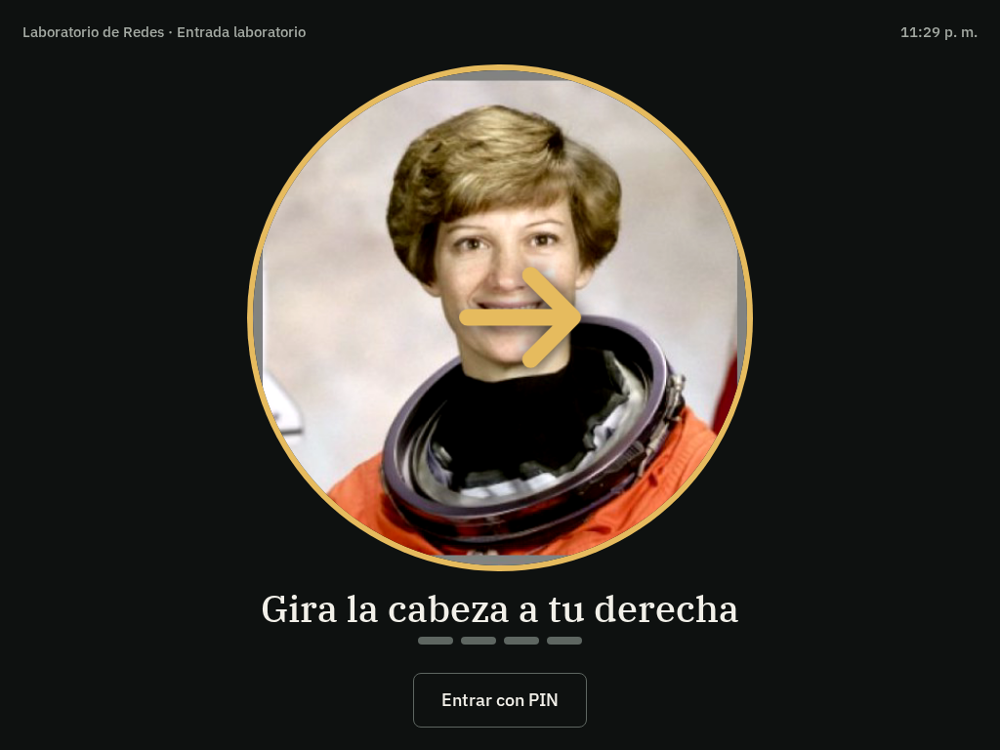
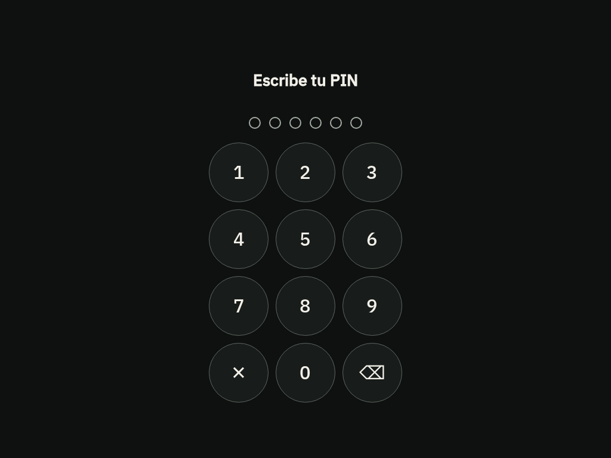

# Portero

Control de acceso y asistencia con rostro o PIN para laboratorios y oficinas. Corre en tu propio servidor, y las plantillas faciales no salen de tu red.



- **Dos credenciales.** Cada persona entra con su rostro, si lo autorizó, o con un PIN. Nadie está obligado a dar datos biométricos.
- **Prueba de presencia.** El kiosco pide girar la cabeza a ambos lados en orden aleatorio, y así frena fotos y pantallas quietas. Los límites están en [docs/seguridad.md](docs/seguridad.md).
- **Permisos por puerta y horario.** Incluye turnos nocturnos y fechas de vencimiento para visitantes.
- **Asistencia.** Primera y última marca por día, con CSV que Excel abre bien.
- **Datos personales bajo control.** Registro de autorización, exportación, supresión y retención automática. Ver [docs/privacidad.md](docs/privacidad.md).
- **Historial a prueba de alteraciones.** Cada registro firma al anterior, y `portero audit` señala la fila modificada.
- **Se conecta a cualquier cerradura.** Portero envía un aviso firmado a la URL que indiques. Hay un [receptor de ejemplo](examples/receptor_puerta.py) para Raspberry Pi.

| El kiosco pide un giro | Teclado de PIN |
|---|---|
|  |  |

## Probarlo en 3 minutos

Necesitas [uv](https://docs.astral.sh/uv/). No hace falta compilar nada ni tener GPU.

```bash
git clone https://github.com/fabiiianac15/AccessControl.git
cd AccessControl
uv sync
uv run portero demo                 # opcional: personas y eventos inventados
uv run portero admin coordinador    # crea tu cuenta (pide una contraseña)
uv run portero serve                # la primera vez descarga los modelos (39 MB)
```

Abre <http://localhost:8000>. Para probar el kiosco en el mismo equipo:

1. En **Puertas**, crea una zona y un kiosco.
2. Abre el enlace que aparece. Solo se muestra una vez.
3. En **Personas**, agrega a alguien, imprime y registra su autorización, y captura su rostro.
4. Dale un permiso para esa zona y ponte frente al kiosco.

Si cargaste la demostración, usa otra carpeta para el uso real (`PORTERO_DATA_DIR=datos-reales`): la demo solo sirve para explorar el panel.

## Instalarlo en una puerta

```bash
cp .env.example .env                # pon el nombre y el contacto de tu organización
docker compose up -d
docker compose exec portero /app/.venv/bin/portero admin coordinador
```

El panel queda en `https://<IP-del-servidor>`. Los navegadores solo permiten la cámara con HTTPS o en localhost, y Caddy crea un certificado local para eso. Cada equipo mostrará una advertencia la primera vez.

En cada kiosco basta un navegador en pantalla completa, una tablet o un mini PC con webcam. Antes de operar con personas reales, lee [la lista de seguridad](docs/seguridad.md#antes-de-instalar-en-una-puerta-real) y [lo que le corresponde a tu organización](docs/privacidad.md#qué-le-corresponde-a-tu-organización).

## Comandos

| Comando | Qué hace |
|---|---|
| `portero serve` | Inicia el servidor |
| `portero admin <usuario> [--role viewer]` | Crea una cuenta o restablece su contraseña |
| `portero audit` | Verifica las cadenas de registros. Sale con código 1 si hay alteraciones |
| `portero purge` | Aplica la retención. Prográmalo a diario |
| `portero models` | Descarga y verifica los modelos |
| `portero demo` | Carga datos inventados en una base vacía |

La configuración se hace con variables de entorno, todas en [.env.example](.env.example).

## Cómo está hecho

```
Kiosco (navegador)  ── cuadros JPEG ──▶  Servidor FastAPI  ── aviso firmado ──▶  Cerradura
Panel (navegador)   ◀── HTML ─────────▶  ├ YuNet + SFace (OpenCV, solo CPU)
                                         └ SQLite: plantillas cifradas, eventos firmados
```

Las decisiones se toman en el servidor. El panel es HTML generado en el servidor con muy poco JavaScript, y las fuentes están incluidas: nada depende de internet ni de un paso de compilación.

Corre en un solo proceso, porque la galería de rostros y las sesiones del kiosco viven en memoria. Alcanza para una sede, pero no está pensado para escalar a varios servidores.

```bash
uv run pytest        # 200+ pruebas; las de modelos descargan los ONNX si faltan
uv run ruff check .
uv run mypy
```

## Qué tan bien funciona

Con 3.200 pares de LFW y el umbral por defecto: 0 falsas aceptaciones entre 1.600 pares de personas distintas y 3,88 % de falso rechazo por par. En 600 fotos con inclinación simulada, ninguna logró imitar los dos giros. [docs/evaluacion.md](docs/evaluacion.md) explica cómo se midió y por qué estas cifras no reemplazan una prueba con tu propia gente.

**Aún no probado:** la prueba de presencia con personas frente a una cámara real, cerraduras físicas y Raspberry Pi. Se validó con cámara simulada, fotos reales y un receptor de puerta por red.

## Más documentación

- [Seguridad](docs/seguridad.md): qué ataques detiene y cuáles no.
- [Privacidad](docs/privacidad.md): Ley 1581 y qué le queda a tu organización.
- [Evaluación](docs/evaluacion.md): mediciones y cómo reproducirlas.
- [Proyección](docs/proyeccion.md): de dónde viene el proyecto y hacia dónde puede ir.

## Licencia

MIT. Los modelos se descargan de [opencv_zoo](https://github.com/opencv/opencv_zoo) con sus propias licencias, y las fuentes IBM Plex usan la licencia SIL OFL.
